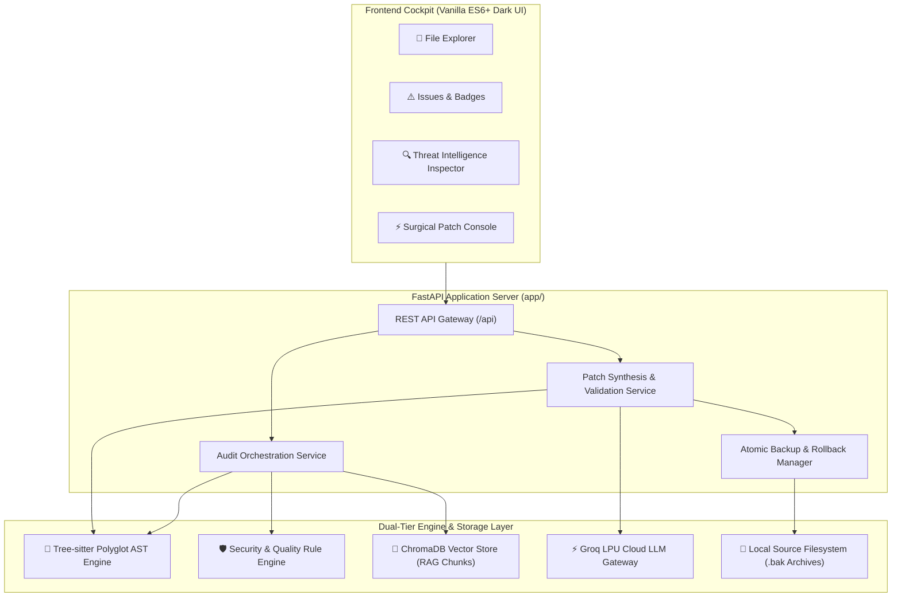

# CodeShield AI 🛡️
> **Cloud-Assisted Polyglot Code Quality, Security Auditor & Surgical Remediation Platform**

[](https://www.python.org/)
[](https://fastapi.tiangolo.com)
[](https://tree-sitter.github.io/)
[](https://www.trychroma.com/)
[](https://groq.com/)
[](https://docs.pytest.org/)
[](LICENSE)

---

## 🌟 Overview

**CodeShield AI** is an enterprise-grade, cloud-assisted code security auditor and surgical patch synthesizer. Traditional Static Application Security Testing (SAST) tools (such as SonarQube or Snyk) merely generate voluminous issue reports, forcing developers to spend countless hours manually researching and writing remediations. Conversely, relying on general-purpose conversational LLMs (like standard ChatGPT) for code remediation frequently introduces breaking syntax errors, hallucinated dependencies, or catastrophic file overwrites.

CodeShield AI bridges this divide with a **Dual-Tier Defensive Shield Architecture**:
1. **Zero-Token Local Static & Rule Engine**: Leverages Tree-sitter AST parsers and deterministic security rules to scan 100+ files in **1–2 seconds** entirely offline at ₹0 cost.
2. **AST-Guided Surgical AI Remediation**: Uses on-demand frontier LLM reasoning with virtual AST compilation pre-flight checks, ensuring that proposed fixes are syntactically sound and non-destructive before touching physical disks.

---

## 🛡️ The 4 Defensive Shields

| Shield | Feature | Engineering Implementation |
| :--- | :--- | :--- |
| **Shield 1** | **Polyglot Threat & Smell Detection** | Tree-sitter Concrete Syntax Tree (CST) analysis for **Python, JavaScript/TypeScript, Java, and C/C++**. Identifies OWASP Top 10 / CWE vulnerabilities (CWE-89 SQLi, CWE-22 Path Traversal, Open CORS, SSRF) and architectural smells (Bottleneck Hubs, Monolithic God Classes, Excessive Nesting). |
| **Shield 2** | **Pre-Flight AST Syntax Shield (US 21)** | Every AI-generated candidate patch is parsed into an abstract syntax tree *in-memory* before application. If an LLM response suffers from truncation, indentation slips, or syntax corruption, CodeShield aborts the write and protects the codebase. |
| **Shield 3** | **Human-in-the-Loop Approval Gate (US 30)** | Strict Two-Phase Commit protocol. AI suggestions are rendered as colored Git-style unified diffs (`+` additions, `-` deletions). Zero code touches the disk without explicit reviewer verification and approval. |
| **Shield 4** | **Non-Destructive Export & Rollback** | **Mode 1 (ZIP Export)**: One-click export of `{project}_patched.zip` without altering local files.<br>**Mode 2 (Atomic Disk Apply)**: Generates SHA-256 verified `.bak` archives with one-click byte-for-byte rollback guarantees. |

---

## 🏛️ System Architecture



---

## ✨ Key Features

* **⚡ Ultra-Fast Offline Audit (Zero Token Consumption)**: Run full-repository scans with the "AI Semantic Scan" toggle turned OFF. Complete AST analysis and deterministic rule matching finish in ~1.5 seconds.
* **🎯 AST-Guided Method Slicing**: Rather than foolishly asking LLMs to reproduce 400-line monolithic files (which causes token truncation and syntax errors), CodeShield's AST engine isolates the exact enclosing function/method, prompts the LLM for that slice only, adjusts class indentation, and seamlessly splices it back.
* **📊 Comprehensive Threat Intelligence**: Live CWE mapping, CVSS severity metrics (Critical, High, Medium, Quality), AI-synthesized exploit walkthroughs, and actionable architectural remediation advice.
* **📦 Non-Destructive Patched ZIP Export**: Test changes safely in staging by downloading an updated `.zip` bundle with all approved remediations pre-applied, keeping local production repositories completely pristine.
* **🎨 Zero-Build Cockpit UI**: Responsive, zero-dependency, pure Vanilla ES6+ frontend with syntax-highlighted editor gutters, gutter warning icons, live telemetry pings, and unified Git diff renderers.

---

## 📂 Project Structure

```text
CodeShield AI/
├── app/                              # Pure Backend Core
│   ├── analysis/                     # Tree-sitter AST, Quality & Rule Analyzers
│   ├── api/                          # FastAPI Routers & Pydantic Schemas
│   │   ├── routes/                   # /projects, /audit, /patches, /health
│   │   └── schemas.py                # Request & Response Contracts
│   ├── core/                         # Domain Entities, Enums, Interfaces
│   ├── infrastructure/               # Groq LLM Client, Local FileSystem & Sanitizer
│   ├── patches/                      # DiffGenerator, BackupManager, PatchApplier, RollbackManager
│   ├── services/                     # AuditService, PatchService, ProjectService
│   └── backend_main.py               # Consolidated FastAPI App Entrypoint
├── config/
│   └── config.yaml                   # Core Engine & Scanner Configuration
├── ui/                               # Pure Frontend Cockpit (Zero-Build)
│   ├── index.html                    # Main Single-Page Dashboard
│   ├── css/                          # Modern Theme Styles (tokens, layout, components)
│   └── js/                           # Controllers (api, audit, editor, findings, patches)
├── tests/                            # 305 Exhaustive Test Suite
│   ├── test_api/                     # FastAPI Endpoint Integration Tests
│   ├── test_patches/                 # Patch Safety & Multi-Layer Stress Tests
│   └── test_US/                      # User Story Sprint Tests (Sprint 1 - 5)
├── main.py                           # Root Application Launcher
├── requirements.txt                  # Python Dependencies
└── .env                              # Environment Variables (GROQ_API_KEY)
```

---

## 🚀 Quickstart Guide

### 1. Prerequisites
* **Python 3.11+** installed on Windows, macOS, or Linux.
* Free **Groq API Key** (obtainable from [Groq Console](https://console.groq.com/keys)).

### 2. Clone & Environment Setup
```bash
# Clone the repository
git clone https://github.com/your-username/codeshield-ai.git
cd "codeshield-ai"

# Create and activate virtual environment
python -m venv venv

# Install dependencies
pip install -r requirements.txt
```

### 3. Environment Configuration
Create a `.env` file in the project root:
```env
GROQ_API_KEY=gsk_your_groq_api_key_here
```

### 4. Run the Application
```bash
python main.py
```
Open your browser at:
* **Cockpit UI**: `http://127.0.0.1:8000/ui`
* **Interactive API Documentation (Swagger UI)**: `http://127.0.0.1:8000/docs`

*(Alternatively, run Live Server on port `5500` pointing to `ui/index.html`)*.

---

## 🧪 Testing & Verification

CodeShield AI is backed by an exhaustive suite of **305 unit, integration, and stress tests** covering AST quarantine, CRLF/Unicode sanitization, empty code wipeout defense, byte-for-byte rollback integrity, and rate-limit model failovers.

```bash
# Run all 305 tests
pytest tests/ -v

# Run targeted patch safety & backend API stress tests
pytest tests/test_patches/ tests/test_api/ -v
```

**Test Result Summary:**
```text
========================= 305 passed, 2 warnings in 59.07s =========================
```

---

## 💡 Recommended User Workflow

1. **Select Target Project**: Choose any local repository (e.g., Python/JS project) from the header dropdown.
2. **Run Fast Audit (Toggle OFF)**: Keep "AI Semantic Scan" OFF and click **"Run Audit"**. Complete AST scan completes in **1–2 seconds** with 0 token consumption.
3. **Inspect Vulnerability**: Select any finding in the left panel (e.g. Path Traversal in `docx_loader.py` or Control Flow Nesting in `sidebar.py`). Review the CWE details and exploit scenario.
4. **Propose Surgical Patch**: Click **"✨ Propose AI Patch"**. View the green `+` and red `-` lines in the Patch Console.
5. **Pre-Flight AST Validation**: Click **"👁️ Validate AST"** to verify that the proposed code satisfies language grammar.
6. **Apply & Shield**:
   * Click **"✅ Approve & Apply"** to write cleanly with an automatic `.bak` backup.
   * Or click **"📦 Export Patched ZIP"** to download the safe archive without touching local source code!

---

## 🎓 Academic / Viva Defense Talking Points

When presenting CodeShield AI to evaluators, examiners, or technical leads, highlight the following:

1. **Task-to-Model Alignment**: Detection and classification are handled locally via Tree-sitter AST and deterministic rules at zero cost; generative AI is reserved strictly for on-demand remediation synthesis.
2. **AST-Guided Method Slicing**: CodeShield avoids the naive anti-pattern of prompting LLMs to rewrite entire 400-line files. By isolating the enclosing function definition via AST parsing, patches generate in <2 seconds with 90% fewer tokens and zero mid-file truncation.
3. **Safety-First Engineering (Fail-Closed Architecture)**: The system enforces pre-flight AST compilation checks and cryptographic SHA-256 backup receipts. Even if an AI model hallucinates or truncates, the safety shield prevents disk corruption.
4. **Pluggable Architecture**: Built on the Adapter Pattern. While demonstrated on Groq's high-speed LPU infrastructure, the LLM client seamlessly switches to enterprise gateways (Anthropic Claude 3.5 Sonnet, OpenAI GPT-4o, or local Ollama) via configuration.

---

## 📄 License
This project is licensed under the [MIT License](LICENSE).
